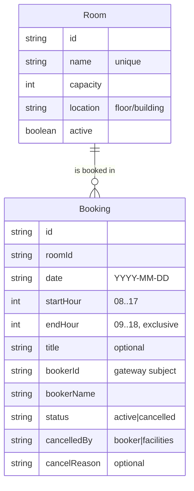

# Domain model

Rooms are bookable in fixed one-hour slots; a booking holds one room, one day and a run of consecutive slots.

- A booking occupies hours startHour to endHour; no two active bookings of a room overlap on a date.
- Deactivating a room cancels its future active bookings with cancelledBy facilities.